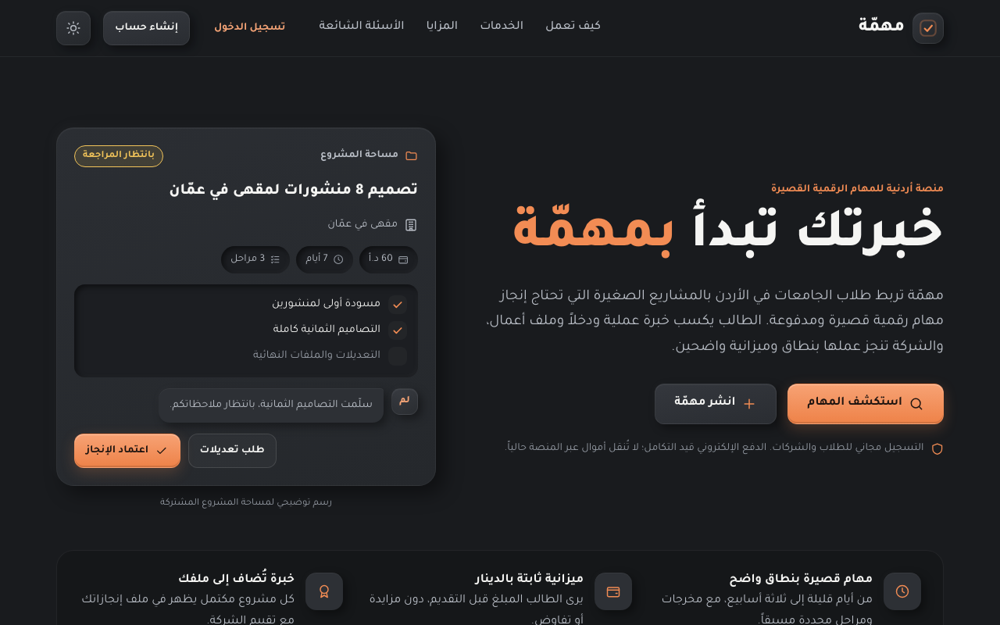
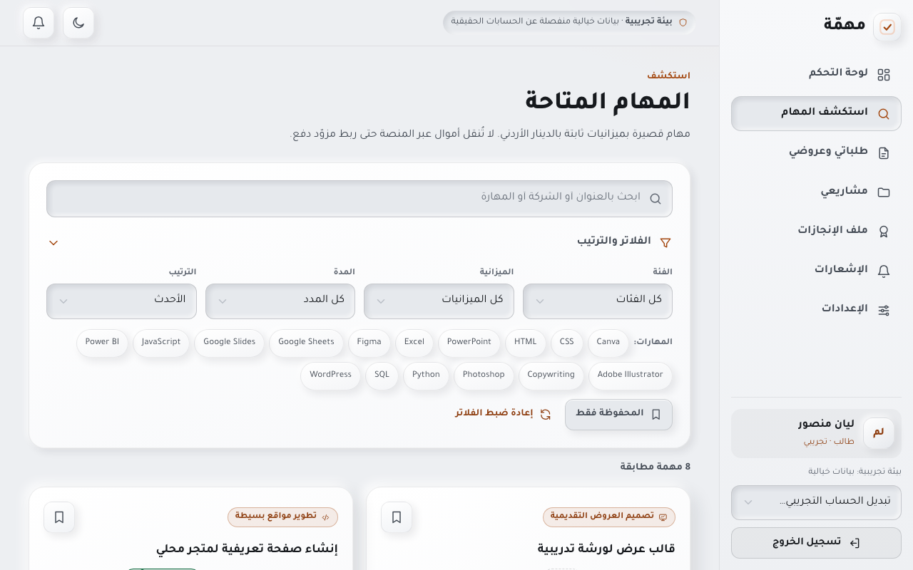
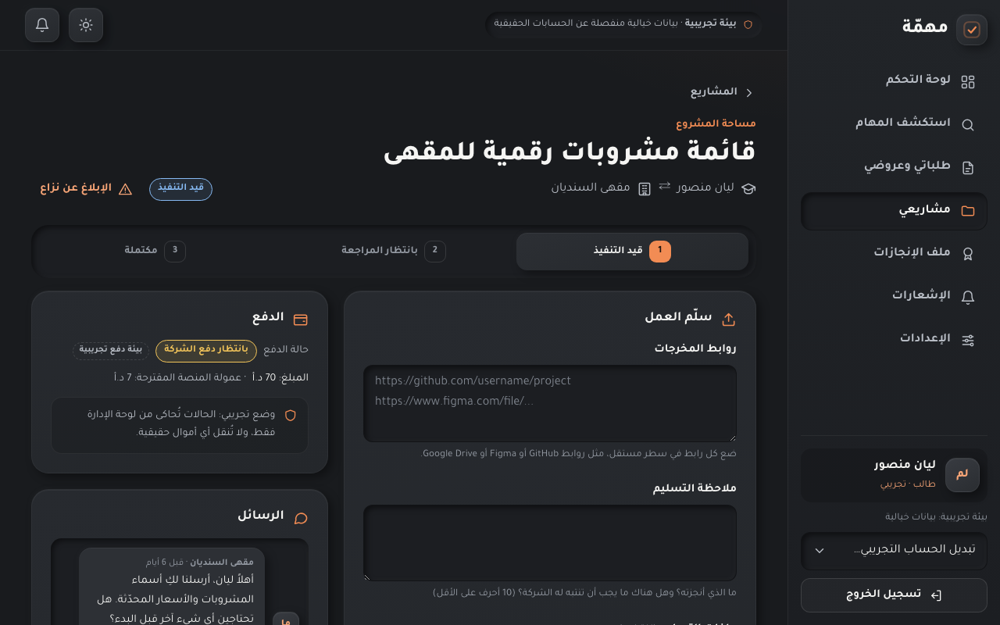
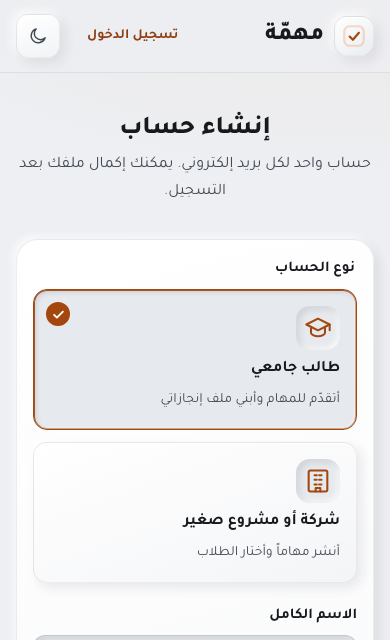
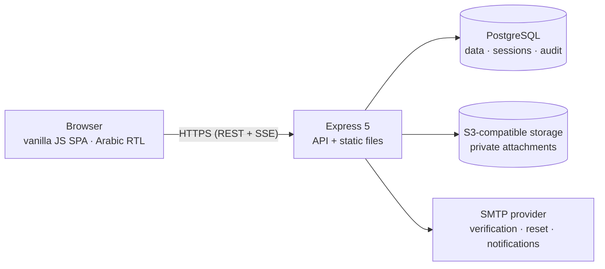

<div align="center">


# مهمّة · Mihmah

<p dir="rtl"><strong>خبرتك تبدأ بمهمّة</strong></p>

<em>Your experience starts with a task.</em>

A marketplace that connects Jordanian university students with small businesses for short, paid, clearly scoped digital projects.

[**Live site**](https://mihmah.onrender.com) · [API reference](docs/API.md) · [Deployment guide](docs/DEPLOY-FREE.md) · [Changelog](CHANGELOG.md)

[](https://github.com/yousefammmar/mihmah/actions/workflows/ci.yml)


</div>

---

## Overview

Small businesses need small digital jobs done: a menu redesign, a landing page, a spreadsheet dashboard. Students need real work for their portfolios. Mihmah brings the two together around fixed budgets, clear deliverables and a shared workspace. It covers the whole engagement from the first posting to the final review:

1. A company publishes a task with a scope, deliverables, milestones, a budget and a deadline.
2. Students discover it, check how their skills match, and apply.
3. The company reviews applicants and sends an offer. The first acceptance wins, enforced in the database.
4. A project workspace opens with messages, private files and milestones.
5. The student delivers, the company approves or asks for revisions, and leaves a rating.
6. The finished project joins the student's portfolio.

## Screenshots

| Landing page (dark) | Task discovery (light) |
| :---: | :---: |
|  |  |
| **Project workspace (dark)** | **Sign-up on a phone (light)** |
|  |  |

<sub>Screenshots use the fictional development data that ships with the repo.</sub>

## Features

**Students**
- Profile with university (39 Jordanian universities and colleges suggested), major, bio, skills (107 grouped suggestions) and a portfolio link.
- Task discovery with Arabic-normalised search, combined filters, sorting, pagination and saved tasks.
- Applications, offers and project tracking, with notifications in the app and by email.
- Portfolio and a printable completion summary for every finished project.

**Companies**
- Company profile with a verification request reviewed by an admin.
- Four-step task editor with server-side drafts.
- Applicant review with skill matching, offers, rejections and withdrawals.
- Milestones, deliverable review, revision requests with required feedback, and approval with a rating.

**Administrators**
- Company verification, a reports queue, task moderation, and user suspension with a recorded reason.
- Dispute inspection and cancellation, an audit log, and payment records with a sandbox event simulator.

**Platform**
- Live updates over server-sent events for messages, offers and notifications.
- Private file attachments with type and size checks, content sniffing and short-lived, user-bound links.
- Light and dark themes. They follow the device setting and switch with one click. Every light-theme text color meets WCAG AA contrast (4.5:1).
- Responsive, mobile-first Arabic RTL interface built from a token-based design system.
- Times stored in UTC and shown in Asia/Amman. Deadlines mean the end of the chosen day in Amman.
- Privacy-conscious Google Analytics. Page views carry route names only, never one-time tokens or record IDs, and analytics is off during local development.

## Tech stack

| Layer | Technology |
| --- | --- |
| Frontend | HTML, CSS and vanilla JavaScript ES modules. No framework, no build step. |
| Backend | Node.js 22+, Express 5 |
| Database | PostgreSQL, accessed with parameterised SQL through `pg` and versioned with plain-SQL migrations |
| Files | S3-compatible object storage (signed requests, no SDK), with a local adapter for development |
| Email | SMTP through `nodemailer`, with a local outbox for development |
| Tests | `node:test` against throwaway, real PostgreSQL clusters |

The app has only three runtime dependencies: `express`, `pg` and `nodemailer`.

## Architecture



The server holds all state: sessions, notifications and project activity live in PostgreSQL. Live updates are signals only, and the browser refetches through the API, so every response goes through the same access checks.

## Getting started

**Requirements:** Node.js 22 or newer. You don't need to install a database or Docker: the development script starts a real PostgreSQL from a dev dependency.

```bash
git clone https://github.com/yousefammmar/mihmah.git
```

```bash
cd mihmah && npm install
```

```bash
npm run dev
```

Then open http://localhost:3000. On first run the script creates the database, applies migrations and loads **fictional** sample data.

| Role | Sample account (development only) |
| --- | --- |
| Student | `lian@student.example.com` (also `omar`, `sara`, `yazan`) |
| Company | `cafe@company.example.com` (also `zaytouna`, `noon`, `darb`, `taboon`, `smile`) |
| Admin | `admin@mihmah.example.com` |

The password for every sample account is `mihmah-demo-2026` (override it with `SEED_PASSWORD`). The server refuses to load sample data into production.

- **Emails** in development go to a local outbox at http://localhost:3000/dev/mail, which only this machine can open.
- **One-click demo logins:** copy `.env.example` to `.env` and set `DEMO_MODE=true`.

## Scripts

| Command | What it does |
| --- | --- |
| `npm run dev` | Development server, plus embedded PostgreSQL when `DATABASE_URL` is unset |
| `npm start` | Production server. Applies pending migrations on boot. |
| `npm test` | The full test suite (47 tests) |
| `npm run migrate` | Applies pending migrations |
| `npm run seed:dev` | Loads fictional data into an empty development or demo database |
| `ADMIN_EMAIL=… npm run admin:create` | Creates an administrator and prompts for the password |

## Testing

```bash
npm test
```

Each test file starts its own temporary PostgreSQL cluster and talks to the real Express app over HTTP, with separate cookie jars acting as separate browsers. The suite covers:
- authentication and sessions
- role and ownership access rules
- the full task-to-portfolio workflow
- offer acceptance races
- private files
- an end-to-end journey across a backend restart
- regression tests for the server-side bugs fixed since the MVP

## Deployment

The live site runs entirely on free plans, with no credit card:

| Piece | Service |
| --- | --- |
| Web server and HTTPS | Render free web service, configured in [`render.yaml`](render.yaml), redeploying on every push to `main` |
| Database | Neon Free PostgreSQL |
| File storage | Backblaze B2, a private bucket |
| Email | Brevo Free over SMTP |

In production the server refuses to start without HTTPS, SMTP, object storage and a file-link secret. Secrets live only in the hosting dashboard, never in Git.

- **Free setup, limits and troubleshooting:** [docs/DEPLOY-FREE.md](docs/DEPLOY-FREE.md)
- **Configuration, backups and the go-live checklist:** [docs/DEPLOYMENT.md](docs/DEPLOYMENT.md)

## Security

- **Accounts:** scrypt password hashing, and server-side sessions in HttpOnly, Secure cookies with absolute and idle expiry. Sessions are revoked on logout, password reset and suspension.
- **Requests:**
  - CSRF protection that checks the Origin and requires a per-session header token.
  - Restricted CORS, a strict Content Security Policy, HSTS and related headers.
  - Rate limits on sign-in, sign-up, password flows, applications, messages and uploads.
- **Data:** parameterised SQL throughout, and role and ownership checks on every endpoint. Admin actions on user data are audited.
- **Logs and errors:** logs are structured with secrets redacted, and error messages never expose internals.
- **Payments:** money movement is disabled by a database constraint. Nothing is marked paid because someone clicked a button.

## Project structure

```text
public/              Frontend served by Express
  css/               Design tokens (light + dark), base, components, layout, pages
  js/                App shell, router, API client, theme, views/*
server/
  app.js             Security headers, CORS, sessions, CSRF, routes, static files
  config.js          Environment parsing; refuses unsafe production settings
  db/                Connection pool, migration runner, migrations/*.sql, dev seed
  lib/               Security, sessions, rate limits, validation, mail, storage, payments, SSE
  routes/            auth, profiles, tasks, projects, inbox, admin, demo
scripts/             Development launcher (embedded PostgreSQL), admin creation
test/                node:test suites and regression tests
docs/                API, state machines, deployment guides, screenshots
render.yaml          Render Blueprint for the free deployment
```

## Status and roadmap

Mihmah is a working MVP, live at [mihmah.onrender.com](https://mihmah.onrender.com). Still to come:

- **Payments:** the provider interface and sandbox are built. A live adapter waits on a merchant contract with a Jordanian provider and regulatory confirmation; the research is in [PAYMENTS-RESEARCH.md](PAYMENTS-RESEARCH.md).
- **Operations:** a custom domain, scheduled database backups, and legal pages (terms, privacy, tax guidance for student earnings).
- **Product:** university-enrolment verification for a "verified student" badge, and an automated browser test suite.

Progress is tracked in [PROGRESS.md](PROGRESS.md), and every change is listed in [CHANGELOG.md](CHANGELOG.md).

## Documentation

| Document | Contents |
| --- | --- |
| [docs/API.md](docs/API.md) | Every endpoint with its auth rules, request body and errors |
| [docs/STATE-MACHINES.md](docs/STATE-MACHINES.md) | Lifecycles of tasks, applications, offers, projects, payments and reports |
| [docs/DEPLOY-FREE.md](docs/DEPLOY-FREE.md) | The free Render + Neon + Backblaze + Brevo setup behind the live site |
| [docs/DEPLOYMENT.md](docs/DEPLOYMENT.md) | Production configuration, backups and restore, release steps, go-live checklist |
| [PAYMENTS-RESEARCH.md](PAYMENTS-RESEARCH.md) | Payment providers in Jordan, evaluated from official documentation |
| [RESEARCH.md](RESEARCH.md) | UX research behind the interface |

## License

Copyright © 2026 Yousef Odeh. All rights reserved. The source is public for reference only; see [LICENSE](LICENSE).

---

<div align="center">

Built by <a href="https://github.com/yousefammmar">@yousefammmar</a>.

</div>
